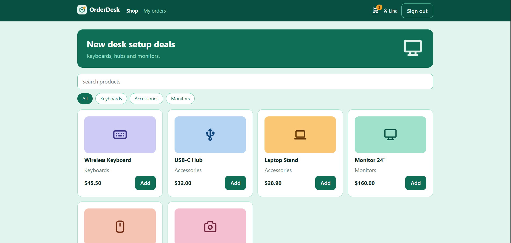
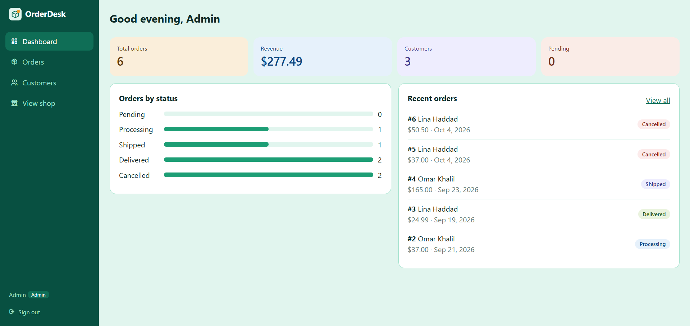

# OrderDesk


A full-stack order management app. Customers sign up, browse products, place orders and track them. Staff and admins manage orders and customers from a dashboard.




## Features

**Customers**

- Sign up and sign in
- Browse and search products, filter by category
- Cart (saved in the browser) and checkout
- Order tracking with live status updates (polls every 15 seconds)
- Cancel an order while it is still pending
- Checkout with a simulated card payment: card details are validated in the browser and never sent to the server
- Discount codes (percent or fixed amount, optional expiry and usage limit), managed by admins
- Printable receipts for paid and refunded orders
- Product view tracking for signed-in customers (one counted view per customer and product every 30 minutes), the first signal for recommendations
- Personalized recommendations on the shop home, product pages and after checkou

  **Staff and admins**

- Dashboard with revenue, order counts and orders by status
- Search and filter orders, update their status
- Customer list with order history and total spent
- Admins can delete orders and create staff accounts
- Product management: create, edit, archive and delete products, with stock tracking and low-stock badges
- Product photos (uploaded from the admin panel),categories, and sorting in the shop
- Paginated lists with filters and page numbers kept in the URL

## Tech stack

| Layer    | Tools                                 |
| -------- | ------------------------------------- |
| Frontend | React, TypeScript, Vite, React Router |
| Backend  | Node.js, Express, TypeScript          |
| Database | PostgreSQL (pg)                       |
| Auth     | JWT, bcrypt                           |
| Testing  | Vitest, Supertest                     |
| CI       | GitHub Actions                        |

## Roles

| Role     | Can do                                                                         |
| -------- | ------------------------------------------------------------------------------ |
| customer | Browse, place orders, see and cancel own pending orders                        |
| staff    | Everything a staff panel needs: view orders and customers, update order status |
| admin    | Everything staff can do, plus delete orders and create staff accounts          |

Customers register themselves. There is no public admin sign-up: the admin is seeded, and staff are created by an admin.

## Payments

Checkout uses a simulated payment gateway that behaves like a real one (Stripe-style):

1. The API creates a payment (`requires_payment`) and returns a signed client secret.
2. The browser sends the card **directly to the gateway**, never to the API.
3. The gateway sends a **signed webhook** (HMAC, with a timestamp) with the result.
4. The API verifies the signature and updates the payment and the order.
5. The browser reads the final status from the API.

Safety: idempotency keys, one open payment per order (partial unique index), row locks, duplicate webhooks ignored, amounts re-checked on confirmation. The gateway sits behind a `PaymentGateway` interface, so a real provider can replace the mock.

Test cards (any future date, any code):

| Card                | Result                  |
| ------------------- | ----------------------- |
| 4242 4242 4242 4242 | Approved                |
| 5555 5555 5555 4444 | Approved (Mastercard)   |
| 4000 0000 0000 0002 | Declined                |
| 4000 0000 0000 9995 | Insufficient funds      |
| 4000 0000 0000 0127 | Incorrect security code |
| 4000 0000 0000 0119 | Processing error        |

Any other number is rejected. Never enter a real card.

## Recommendations

`GET /api/recommendations` ranks products with a transparent, explainable score. Signals are normalized to 0..1 and combined:

| Signal                                                                | Weight |
| --------------------------------------------------------------------- | ------ |
| Often bought together with the customer's past purchases              | 3      |
| Categories of the customer's last 5 orders (recent orders count more) | 2      |
| Categories the customer viewed in the last 30 days                    | 1.5    |
| Same category as the product being viewed (product pages)             | 1      |
| Best sellers of the last 90 days (also breaks ties)                   | 0.5    |

Rules: out-of-stock, archived and already purchased products are never suggested; no more than 3 products per category; guests, new customers and staff get best sellers; every suggestion carries a reason shown in the UI. The scoring is a pure function (`server/src/ranking.ts`) with unit tests, and the SQL that collects the signals is covered by integration tests.

## Getting started

Requirements: Node.js 20 or newer.

```bash
# Database
docker compose up -d

# API
cd server
npm install
cp .env.example .env      # set JWT_SECRET, keep DATABASE_URL
npm run db:setup          # migrations + demo data
npm run dev               # http://localhost:4000
```

# Web app (new terminal)

cd client
npm install
npm run dev # http://localhost:5173

````

On first start the API seeds demo data and prints the demo accounts:

| Role     | Email             | Password     |
| -------- | ----------------- | ------------ |
| admin    | admin@example.com | Admin123!    |
| customer | lina@example.com  | Customer123! |

## Database (PostgreSQL)

```bash
docker compose up -d                 # start PostgreSQL
cd server
cp .env.example .env                 # set JWT_SECRET, keep DATABASE_URL
npm run db:setup                     # run migrations and seed demo data
npm run db:reset                     # wipe and rebuild (local databases only)
````

Schema changes live in `server/db/migrations` as numbered SQL files. They run in order, each inside a transaction, and applied files are tracked in the `schema_migrations` table.

## Tests

Integration tests need an `orderdesk_test` database (see docker compose). Create it once with:

```bash
docker compose exec db psql -U orderdesk -d postgres -c "CREATE DATABASE orderdesk_test;"
```

Then run:

```bash
cd server && npm test     # unit + integration (in-memory database)
cd client && npm test
```

The integration tests cover authentication, role-based access, server-side pricing, stock handling and cancellation rules.

## Demo data

Build a realistic dataset (20 products with photos, 25 customers, about 100 orders over 60 days with payments, refunds, discount codes and product views) with one command:

```bash
cd server
npm run demo:seed -- --fresh        # local database
DATABASE_URL='postgresql://...' npm run demo:seed -- --remote   # a hosted database
npm run demo:clear                  # remove only the generated customers, orders and views
```

The data is generated with a seeded random generator, so it is identical on every run. Everything it creates is marked (`@demo.test` emails, `[demo]` addresses), so it can be removed safely. Demo customers get random passwords nobody knows. Existing products and photos are never overwritten. Product photos live in `server/db/demo-images` (see `CREDITS.md`).

## API overview

| Method | Endpoint                               | Access                                                        |
| ------ | -------------------------------------- | ------------------------------------------------------------- |
| POST   | /api/auth/register                     | public (creates a customer)                                   |
| POST   | /api/auth/login                        | public                                                        |
| GET    | /api/auth/me                           | signed in                                                     |
| POST   | /api/staff                             | admin                                                         |
| GET    | /api/products, /api/products/:id       | public                                                        |
| POST   | /api/orders                            | customer                                                      |
| GET    | /api/orders/mine                       | customer                                                      |
| POST   | /api/orders/:id/cancel                 | customer (own pending orders)                                 |
| GET    | /api/orders/:id                        | owner, staff, admin                                           |
| GET    | /api/orders                            | staff, admin (filters: status, search)                        |
| PATCH  | /api/orders/:id/status                 | staff, admin                                                  |
| DELETE | /api/orders/:id                        | admin                                                         |
| GET    | /api/customers, /api/customers/:id     | staff, admin                                                  |
| GET    | /api/stats                             | staff, admin                                                  |
| GET    | /api/admin/products                    | staff, admin                                                  |
| POST   | /api/products                          | admin                                                         |
| PATCH  | /api/products/:id                      | admin                                                         |
| DELETE | /api/products/:id                      | admin (409 if the product is in orders)                       |
| GET    | /api/categories                        | public                                                        |
| GET    | /api/products?category=&search=&sort=  | public (sort: newest, price_asc, price_desc, name             |
| GET    | /api/products/:id/image                | public                                                        |
| PUT    | /api/products/:id/image                | admin (JPEG, PNG or WebP, max 1 MB)                           |
| DELETE | /api/products/:id/image                | admin                                                         |
| POST   | /api/payments                          | customer (needs an Idempotency-Key header)                    |
| GET    | /api/payments/:id                      | owner, staff, admin                                           |
| POST   | /api/webhooks/gateway                  | the gateway (HMAC signature required)                         |
| POST   | /mock-gateway/v1/confirm               | the browser, with a client secret (simulated externalservice) |
| POST   | /api/orders/quote                      | customer (price preview with an optional discount code)       |
| GET    | /api/admin/discounts                   | staff, admin                                                  |
| POST   | /api/discounts                         | admin                                                         |
| PATCH  | /api/discounts/:id                     | admin (enable, disable, change expiry or limit)               |
| POST   | /api/products/:id/view                 | customer (counted once per 30 minutes per product)            |
| GET    | /api/recommendations?limit=&productId= | public (personalized for signed-in customers)                 |

List endpoints (`/api/orders`, `/api/customers`, `/api/products`, `/api/admin/products`) return `{ items, total, page, pages }` and accept `page` and `limit` (default 10, shop 12, max 50). Pages beyond the last one return the last page.

## Design decisions

- **The server is the source of truth for money.** The client sends product ids and quantities only. Prices and totals are read from the database when the order is placed.
- **Stock changes happen in a transaction.** Placing an order checks stock, creates the order and its items, and decrements stock together. If anything fails, everything rolls back. Cancelling restores stock.
- **Order items keep a snapshot** of the product name and price at purchase time, so later price changes do not rewrite history.
- **Three layers of access control:** route guards in the UI, hidden controls, and `authorizeRoles` middleware on the API. Only the last one is a real security boundary.
- **Roles never come from the client.** Registration always creates a customer.
- **Customers cannot discover other people's orders:** requesting someone else's order returns 404, not 403.
- **Images live in PostgreSQL.** The browser resizes photos to 900px before upload, the API checks the real file type from its first bytes (SVG is rejected), and responses are cached by version number. For a larger catalog, move them to object storage.
- **Card numbers never reach the server.** The browser validates the card (Luhn check, expiry, security code) and sends only the brand and the last four digits. Orders have a separate payment status, and an order must be paid before it can move to processing, shipped or delivered. Revenue only counts paid orders.
- **Pricing is server-side and exact.** Money is calculated in cents, the client never sends totals, and the database enforces `total = subtotal - discount + shipping`. A discount can never go below the subtotal, so shipping is always charged.
- **Codes are consumed under a row lock**, so concurrent orders cannot exceed a usage limit. Cancelling an order gives its use back. Code type and value cannot change after creation, so order history stays meaningful.
- **Quote vs. order:** the cart preview reports a bad code as a message, while placing an order with a bad code is rejected (422).
- **View tracking is deduplicated on the server.** One row per customer and product keeps the table small, and a single atomic `INSERT ... ON CONFLICT DO UPDATE ... WHERE` counts at most one view per 30-minute visit, even for concurrent requests. The client adds a 2-second delay and a per-tab memory only to save requests. Tracking failures never affect the page. Views belong to the customer and are deleted with the account or the product, and no endpoint exposes them to other users.

## Project structure

```
client/src
  auth/       auth context, role guard
  cart/       cart context (localStorage)
  components/ shared UI (logo, tracker, dialogs)
  layouts/    customer and admin layouts
  pages/      shop, cart, my orders, admin/*
server/src
  app.ts      routes and middleware
  db.ts       schema and seed data
  auth.ts     JWT and role middleware
  validation.ts
server/tests  unit and integration tests
```

## Live demo

- App: https://order-manager-chi-six.vercel.app
- API health: https://order-manager-1-w38n.onrender.com/api/health

The API runs on a free plan and sleeps when idle, so the first request can take up to a minute.

Demo accounts:

| Role     | Email             | Password     |
| -------- | ----------------- | ------------ |
| customer | lina@example.com  | Customer123! |
| admin    | admin@example.com | Admin123!    |

## Deployment

| Part     | Service                   |
| -------- | ------------------------- |
| Database | Neon (PostgreSQL)         |
| API      | Render (Node web service) |
| Web app  | Vercel                    |

Environment variables: `DATABASE_URL`, `JWT_SECRET` and `CLIENT_ORIGIN` for the API; `VITE_API_URL` for the web app. Migrations run automatically when the API starts.

## Possible next steps

- Pagination for orders and customers
- httpOnly cookie sessions instead of localStorage tokens
- Rate limiting on login
- Product management screens for admins
- WebSocket updates instead of polling
- Docker setup and a hosted demo
